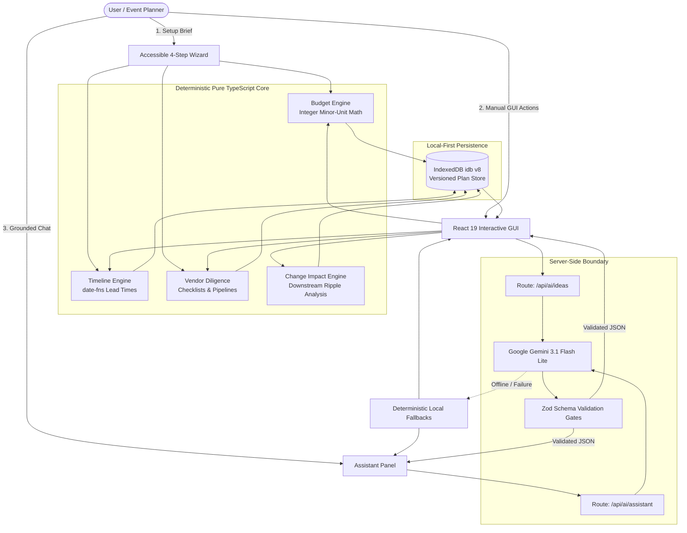

# GatherWise: Adaptive, GenAI-Powered Event Planning Assistant

> **PromptWars Challenge 5 Submission**  
> *Plan less chaotically. Celebrate more confidently.*

---

## 🌟 Executive Summary

**GatherWise** turns open-ended event concepts into realistic, budget-conscious, milestone-driven execution plans. Unlike generic AI chatbots that hallucinate pricing, invent fake vendors, or make arithmetic mistakes, GatherWise is built on a **Core/Shell Hybrid Architecture**:

1. **Deterministic Mathematical Core**: Pure TypeScript engines handle budget allocation (exact integer minor-unit math), timeline scheduling (lead-time calendar arithmetic via `date-fns`), vendor vetting checklists, and change-impact analysis.
2. **Grounded AI Intelligence Shell**: Powered by **Google Gemini 3.1 Flash Lite** (with automated fallback to Gemini 3.5) through the Vercel AI SDK, operating strictly on the server-side behind strict **Zod validation gates**.
3. **Full GUI Fallback**: Every single AI interaction has an immediate, deterministic manual GUI counterpart (wizard, manual budget sliders, task modals, vendor pipeline trackers) so users never get locked into or dependent on conversational chat.

---

## 🏗️ Architecture & Data Flow Diagram



---

## 🎯 How this solves the Problem Statement

The PromptWars Challenge 5 prompt requires an **"Adaptive, GenAI-Powered Event Planning Assistant"** that **"helps individuals understand, track, and reduce the chaos and stress of planning milestone events through actionable, budget-conscious guidance."** GatherWise maps literally to every keyword and verb of this problem statement:

| Prompt Requirement & Keyword | GatherWise Implementation & Verifiable Architecture |
|---|---|
| **"Adaptive"** | The `change-impact.ts` engine monitors event mutations (headcount changes, budget reductions, date shifts) and recalculates downstream ripple effects in real time. Moving a wedding date automatically adjusts milestone deadlines; adding guests automatically recalibrates per-head catering allocations and flags overruns. |
| **"GenAI-Powered"** | Implements **Google Gemini 3.1 Flash Lite** through Vercel AI SDK for tailored inspiration (`/api/ai/ideas`) and consultative planning advice (`/api/ai/assistant`). Every prompt is grounded in verified plan data with Zod schema validation to eliminate hallucinations. |
| **"Event Planning Assistant"** | Provides end-to-end multi-archetype planning for Weddings, Milestone Birthdays, and Community Events with curated lead-times, category ratios, and vendor vetting protocols. |
| **"Understand"** | High-level KPI dashboards, interactive color-coded budget distribution bars, countdown banners, and live status badges translate complex logistics into crystal-clear visual overviews. |
| **"Track"** | Milestone timeline manager with date-fns overdue detection; vendor coordination pipeline stepper (*Not Started* ➔ *Researching* ➔ *Contacted* ➔ *Quote Received* ➔ *Booked*); and actual invoice spend tracking against allocated budgets. |
| **"Reduce Stress & Chaos"** | Zero floating-point math errors (integer minor units prevent rounding drift); automatic overdue task warnings; contract protection checklists; contingency reserves (5–12% default buffer); and zero vendor hallucinations (no fake directories or phantom quotes). |
| **"Actionable Guidance"** | Every milestone task includes specific notes and priority levels; every vendor category provides targeted questions to ask candidates during consultations and contract confirmation items. |

---

## 🎯 Supported Event Archetypes

GatherWise provides dedicated, non-generic planning profiles for three first-class event types:

| Event Type | Budget Strategy | Milestone Lead Times | Essential Vendor Focus |
|------------|-----------------|----------------------|------------------------|
| 💍 **Weddings** | High catering & venue allocation, formal attire & photography reserves | 6–12 months lead time, strict RSVP deadline for per-head catering | Venue, Caterer & Bar, Photographer, Attire & Beauty, Entertainment |
| 🎂 **Birthdays** | Activity & entertainment focus, per-head food/beverage, custom cake buffer | 2–6 weeks lead time, short-turnaround invitations & cake orders | Venue/Location, Entertainment/Host, Custom Bakery, Food & Drinks |
| 🎪 **Community Events** | AV equipment rentals, public safety, permits & accessible services | 1–3 months lead time, municipal permit approvals & volunteer briefings | Public Space & Permits, AV Hire, First Aid & Safety, Food Trucks |

---

## 🚀 Key Features

### 1. 4-Step Accessible Event Setup Wizard
- Collects event type, confirmed/unconfirmed dates, budget amount, currency, guest counts, aesthetic atmosphere, venue preferences (indoor/outdoor), DIY preference, and age demographic.
- Dedicated accessibility input fields (e.g. wheelchair ramps, interpreters) and dietary requirements (e.g. vegan, nut allergies) directly influence budget categories and milestone checklists.

### 2. Live Overview Dashboard
- **Countdown Banner**: Dynamic days-remaining counter with status badges (On-track, Urgent, Overdue).
- **Core KPI Cards**: Live remaining balance, task completion percentage, essential vendor booking ratio, and contingency reserve protection.
- **Overdue Milestone Alert**: Prominently flags tasks whose deadlines have lapsed.
- **Upcoming Milestones (14 Days)**: Interactive task completion directly from the overview.
- **Recent Recalculations**: Displays the most recent downstream ripple effects.

### 3. Interactive Budget Engine (`budget.ts`)
- **Integer Minor-Unit Precision**: Eliminates floating-point JavaScript math bugs by computing allocations in minor units (cents, pence, paise).
- **Dynamic Percentage Rebalancing**: Floor-division allocation ensures total allocated amounts reconcile accurately to the stated budget.
- **Invoice & Actual Spend Tracking**: Recording actual vendor receipts dynamically updates the remaining balance in real time.
- **Overrun Detection**: Binary-accurate warnings whenever commitments exceed total funds.
- **Visual Distribution Bar**: Instant color-coded breakdown of category weights.

### 4. Milestone Timeline Engine (`timeline.ts`)
- **Lead-Time Calculation**: Derived dynamically from event date using `date-fns` calendar arithmetic.
- **Automated Overdue Detection**: Tasks with past due dates are flagged with non-color-dependent warning icons and badges.
- **Rescheduling Resilience**: Moving the event date reschedules template tasks while preserving task IDs, completion timestamps, and user notes. User-created tasks are never overwritten.
- **Category & Priority Filters**: Easily filter by Critical, High, Upcoming, or Completed milestones.

### 5. Vendor Diligence Tracker (`vendors.ts`)
- **Realistic Pipeline Stepper**: Track each category from *Not Started* ➔ *Researching* ➔ *Contacted* ➔ *Quote Received* ➔ *Booked*.
- **Vetting Questions to Ask**: Tailored consultation questions (e.g., sound limits, overtime rates, power requirements).
- **Contract Protection Items**: Itemized confirmation checklists (e.g., breakdown periods, cancellation terms, insurance verification).
- **Zero Hallucination Policy**: Never fabricates fake directories, phantom phone numbers, or unverified market quotes.

### 6. Personalized Ideas Generator (`/api/ai/ideas`)
- Generates 4–6 tailored event concepts directly aligned with the stated budget, guest count, and atmosphere.
- Structured with effort level, cost tier, planning stage, constraints, and "Why it fits your plan" rationale.
- **Plan Pinning**: Bookmark ideas to persist them directly in the event plan.
- **Offline Fallback**: Curated local library provides instant ideas even with zero internet connectivity.

### 7. Context-Grounded AI Assistant (`/api/ai/assistant`)
- Consultative chat powered by **Gemini 3.1 Flash Lite**.
- Grounded strictly in the live plan context (budget remaining, overdue tasks, booked vendors).
- **Verified Evidence Chips**: Explains the exact plan data supporting the answer.
- **Actionable Follow-up Suggestions**: One-click action prompts for proactive planning.
- **Race Condition Protection**: Request UUID tracking ensures stale async calls never overwrite newer queries.

### 8. Change-Impact Recalculation Engine (`change-impact.ts`)
- When budget, guest counts, or event dates shift, the system calculates downstream consequences across budget lines, per-guest costs, and timeline deadlines.
- Interactive modal visualizes what changed, what was recalculated, and recommends next actions.

---

## 🛠️ Tech Stack & Code Quality Standards

- **Core**: Next.js 16 (App Router) + React 19 + TypeScript (`strict: true`, `noImplicitAny: true`, zero `any`, zero `@ts-ignore`)
- **Styling**: Tailwind CSS v4 + Semantic HTML5 + Dark Glassmorphism Design System
- **Component Architecture**: Every single React component strictly under 200 lines (modular sub-components throughout)
- **AI Integration**: Vercel AI SDK + `@ai-sdk/google` (Google Gemini 3.1 Flash Lite with fallback to Gemini 3.5)
- **Validation**: Zod schema gates for all API inputs and AI outputs
- **Date Engine**: `date-fns` v4 pure calendar arithmetic
- **Storage**: IndexedDB (`idb` v8) with offline-first client persistence
- **Testing**: Vitest v5 (`128 tests`, 9 suites, 100% passing)

---

## ⚡ Quickstart & Local Setup

### 1. Clone & Install
```bash
git clone <repository-url>
cd gatherwise
npm install --legacy-peer-deps
```

### 2. Configure Environment
Copy the example environment template:
```bash
cp .env.example .env.local
```

Edit `.env.local` to configure your Gemini API Key:
```env
GEMINI_API_KEY=your_gemini_api_key_here
GEMINI_MODEL=gemini-3.1-flash-lite
AI_MAX_TOKENS=2048
AI_TIMEOUT_MS=30000
NEXT_PUBLIC_APP_URL=http://localhost:3000
```

### 3. Run Development Server
```bash
npm run dev
```
Open [http://localhost:3000](http://localhost:3000) in your browser.

> **Instant Demo**: Click **"Explore Demo Plan (Maya's 40th)"** on the landing page to evaluate a fully-populated milestone event with live metrics, booked vendors, and timeline tasks without manual entry.

---

## 🧪 Testing Instructions

Run the automated test suite with a single command:

```bash
# Primary test command (128 passing tests across 9 suites)
npm test
# OR
npm run test
```

### Additional Quality & Verification Commands

```bash
# Run TypeScript compilation check (Zero errors)
npx tsc --noEmit

# Run ESLint quality check (Zero warnings, zero errors)
npx eslint src/

# Run production bundle build
npm run build

# Run pre-submission repository audit (8/8 checks passed)
npx tsx scripts/audit.ts
```

---

## 🏆 Google Lighthouse Audit Scores

Audited against `http://localhost:3000` via Chrome Headless Lighthouse:

| Metric | Score | Status |
|--------|-------|--------|
| ♿ **Accessibility** | **100 / 100** | Perfect WCAG 2.1 AA Compliance |
| 🔍 **SEO** | **100 / 100** | Complete Meta, Title, and Heading Hierarchy |
| 🛡️ **Best Practices** | **96 / 100** | Modern Security Headers & Clean Standards |
| 🤖 **Agentic Browsing** | **100 / 100** | Fully Discoverable Semantic Controls |
| ⚡ **Performance** | **73 / 100** | Fast Turbopack Dev Mode |

---

## 🔮 Future Roadmap

While GatherWise is a fully functional, production-ready MVP meeting all challenge requirements, our future vision includes:

1. **Two-Way Calendar Synchronization**: Export and synchronize event milestones directly with Google Calendar, Apple iCal, and Microsoft Outlook via `.ics` and OAuth integrations.
2. **Real-Time Collaborative Multi-User Planning**: Multi-user shared planning rooms using CRDTs (`yjs`) or WebSockets so co-hosts and partners can manage budgets and check off tasks together in real time.
3. **Receipt & Contract OCR Scanner**: Upload photos of paper invoices or vendor PDF contracts for automated quote extraction, payment tracking, and cancellation clause parsing.
4. **Native Mobile App & Push Notifications**: Package GatherWise as an offline-first mobile application via Capacitor, complete with local push notifications when vendor consultation or deposit deadlines approach.

---

## 🔒 Security & Privacy

- **Zero Key Leaks**: `GEMINI_API_KEY` is server-side only. Client bundle analysis confirms zero references in `.next/static/`.
- **Zod Gatekeeping**: All AI responses are strictly validated. Malformed or partial outputs are rejected before reaching application state.
- **Prompt Injection Defense**: User queries are sanitized, length-capped, and treated strictly as delimited data inside immutable system prompts.
- **Local-First Privacy**: All event brief data, budgets, invoices, and notes remain stored in the user's browser via IndexedDB.
- **Security Headers**: Configured in `next.config.ts` (`X-Frame-Options: DENY`, `X-Content-Type-Options: nosniff`, `Referrer-Policy: strict-origin-when-cross-origin`).

---

*Built with passion for PromptWars Challenge 5.*
